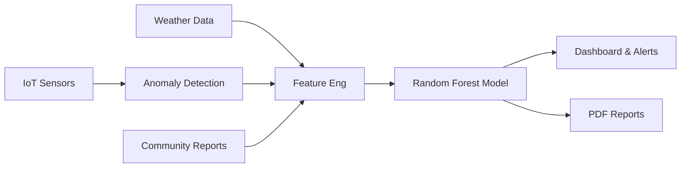

# AquaSentinel 🛡️💧
**Predict. Protect. Prevent.**

A comprehensive, AI-driven platform for predicting waterborne disease outbreaks, monitoring water quality, and managing sanitation. Built for the Hackathon Track 2 (SDG 6).

## Features
- **Live IoT Monitoring**: Real-time anomaly detection for water quality sensors using Isolation Forests.
- **Disease Outbreak Prediction**: A Random Forest ML model predicts the likelihood of waterborne disease surges 7 days in advance based on WQI, rainfall, and sanitation data.
- **Actionable Intelligence**: Auto-generates PDF risk reports and recommended actions.
- **Community Reports**: Allows citizens to report issues like sewage overflow or broken taps.

## Architecture


## How to Run
Ensure you have Python 3.10+ installed.

### Windows
```cmd
run_all.bat
```

### Linux/Mac
```bash
bash run_all.sh
```

## Project Structure
- `app/`: Streamlit dashboard and UI components.
- `src/`: Core Python modules (ML, data generation, processing).
- `data/` & `sample_data/`: Datasets.
- `notebooks/`: EDA and model analysis.
- `assets/`: Custom CSS and SVGs.
